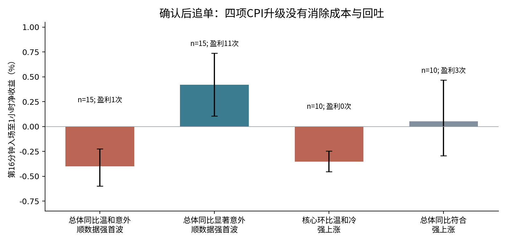
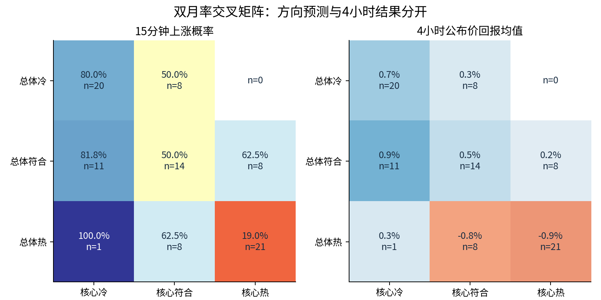

# 美国CPI与BTC四指标历史事件回测最终报告

2019-01-11至2026-09-11，92次正式发布。研究截止2026-10-11，升级复算日期2026-10-12。

## 1. 执行摘要：第一波何时值得信，何时容易追在错误位置

**最强的实际用途是避免温和意外之后追逐强首波。没有发现通过多重检验和时间稳定性检查的正收益交易系统。核心环比提供了重要的分组信息，但加入核心数据没有自动提升时间留出预测。**

| 触发条件 | n | 1h追单净胜率，95%CI | 1h净均值，95%CI | 4h真正反转，95%CI | 4h追单净均值 |
| --- | --- | --- | --- | --- | --- |
| 总体同比温和±0.1pp，顺数据强首波 | 15 | 1/15 (6.7%) [1.2,29.8] | -0.40% [-0.60%,-0.23%] | 8/15 (53.3%) [30.1,75.2] | -1.11% [-1.81%,-0.44%] |
| 总体同比显著>=0.2pp，顺数据强首波 | 15 | 11/15 (73.3%) [48.0,89.1] | +0.42% [+0.11%,+0.74%] | 6/15 (40.0%) [19.8,64.3] | -0.14% [-1.31%,+1.03%] |
| 核心环比-0.1pp，BTC上涨>=0.3% | 10 | 0/10 (0.0%) [0.0,27.8] | -0.35% [-0.45%,-0.25%] | 3/10 (30.0%) [10.8,60.3] | -0.49% [-1.27%,+0.26%] |
| 总体同比符合，BTC上涨>=0.3% | 10 | 3/10 (30.0%) [10.8,60.3] | +0.05% [-0.29%,+0.47%] | 1/10 (10.0%) [1.8,40.4] | +0.29% [-1.03%,+1.37%] |

温和组与显著组1小时净均值差为-0.819个百分点，95%CI [-1.182,-0.459]，置换p=0.0002，18项主检验BH q=0.0036。这支持两组存在历史差异；显著组本身的正均值仍未通过全部策略筛选后的显著性与年份稳定性检查，不能把比较显著等同于可部署策略。

核心环比温和偏冷的10次强上涨，1小时追多0次净盈利，4小时仅5次盘中触达公布价、3次完整5分钟收盘反转。新增B策略实际仅触发3笔：反转后持有1小时2/3净盈利；至事件4小时退出3/3，但均为极低样本。**追多亏损、回吐、真正反转、反向交易赚钱是四个不同事件。**

双月率偏冷的首波上涨16/20，双月率偏热的首波下跌17/21。双月率暴热6次首波却仅3次下跌；双月率暴冷4次有3次上涨。极端组尤其稀疏，不能直接外推胜率。总体月率暴热且核心月率符合，以及核心月率暴热且总体符合或偏冷，都没有观测事件。

时间留出模型：预测15分钟上涨，总体两项准确23/31=74.2%，核心两项20/31=64.5%，四项组合20/31=64.5%；四项组合的Brier和log loss也稍差，差值区间均跨零。不能宣称核心环比一定更有预测力，也不能由这31次证明它永远无用。

## 2. 数据、分母与可复现审计

| 年份 | 正式事件数 |
| --- | --- |
| 2019 | 12 |
| 2020 | 12 |
| 2021 | 12 |
| 2022 | 12 |
| 2023 | 12 |
| 2024 | 12 |
| 2025 | 11 |
| 2026 | 9 |

92=2019至2024各12次+2025年11次+2026年9次。2025年10月参考月没有发布CPI；2025-10-24发布延迟的9月数据，仍计入。2025-12-18没有可用的两项当月MoM实际/预期，不能用新闻稿中的两个月累计0.2%代替。两项同比各92组、两项环比各91组；所有92次BTC均纳入，月率矩阵有效91、同比矩阵92、总体同比×核心环比91，缺失独立列示。

原项目的184个Binance每日ZIP及官方CHECKSUM、92份BLS新闻稿、368个事件前ALFRED版本、92段Coinbase核验记录和完整源码均已找到。当前提供的cpi_events(1).csv与原项目92行数据库完全一致；补充CSV全部74项核对通过。原研究会计/缺失审计通过，升级18项测试通过，包含所有5322条执行情景的实际入场/出场价、下一分钟入场、反杀和延迟信号先后检查。

独立从原始ZIP重算735个有效5/10/15/30/60/120/240/1440分钟回报，与升级CSV最大误差4.47e-13；184/184官方SHA256吻合。92条4小时路径全部完整；2021-02-10的24小时路径缺2021-02-11 03:41至04:59 UTC共79分钟，因此整条24h路径剔除，24h n=91。1380条确认窗×目标窗路径中1377条有效。没有用插值、其他交易所或终点价补出缺失路径。

四项实际来自当次BLS，预期来自事后获取的Investing历史日历字段。保留来源URL、事件ID、官方一致性和历史可用性标记，**没有逐次独立封存发布前08:29调查快照**。因此精确说，这是可审计的历史日历预期回测，不是每个时点均获得独立封存调查数据的PIT认证。旧报告关于当时预期的强表述必须收窄。

当前成交模拟使用Binance BTCUSDT现货分钟OHLCV。主成本24bp是每边10bp参考费用加每边2bp假定滑点，不是实际账户历史成交成本。已核验零手续费活动期间另测4bp滑点情景；做空假设可借BTC，未纳入借币费用、资格与永续资金费。所有策略结果是可执行价格模拟及成本情景，不能承诺未来在分钟open成交。

## 3. 四项CPI分类与完整交叉矩阵

| 名称 | 定义 | 有效事件 |
| --- | --- | --- |
| 总体环比 Headline MoM | 当月总体变化，季调 | 91 |
| 核心环比 Core MoM | 除食品能源当月变化，季调 | 91 |
| 总体同比 Headline YoY | 总体12个月变化，未季调 | 92 |
| 核心同比 Core YoY | 除食品能源12个月变化，未季调 | 92 |

| 五档操作性分类 | 实际减预期（pp） |
| --- | --- |
| 暴冷 | <=-0.2 |
| 小幅偏冷 | -0.1 |
| 符合预期 | 0 |
| 小幅偏热 | +0.1 |
| 暴热 | >=+0.2 |

“暴”只是用户指定的操作性意外阈值，既不是市场公认定义，也不是实际同比通胀很高/很低。实际与预期先转换为0.1pp整数刻度再相减，避免0.099999浮点误判。符合预期是展示精度一致，不等于没有信息。另保存>=0.3pp及过去24个非缺失事件误差标准差归一化结果，至少12个先前观测，绝不包含当前误差。

| 指标 | 暴冷 | 温和冷 | 符合 | 温和热 | 暴热 | 缺失 |
| --- | --- | --- | --- | --- | --- | --- |
| 总体环比 | 6 | 22 | 33 | 20 | 10 | 1 |
| 核心环比 | 11 | 21 | 30 | 21 | 8 | 1 |
| 总体同比 | 6 | 26 | 24 | 23 | 13 | 0 |
| 核心同比 | 10 | 21 | 30 | 20 | 11 | 0 |

### 3.1 总体环比×核心环比：主分析

| 总体/核心 | n | 15m上涨，95%CI | 15m均值，95%CI | 1h均值，95%CI | 4h均值，95%CI |
| --- | --- | --- | --- | --- | --- |
| 偏冷/偏冷 | 20 | 16/20 (80.0%) [58.4,91.9] | +0.77% [+0.31%,+1.31%] | +0.99% [+0.35%,+1.76%] | +0.72% [-0.23%,+1.71%] |
| 偏冷/符合 | 8 | 4/8 (50.0%) [21.5,78.5] | +0.37% [-0.14%,+0.91%] | +0.36% [-0.15%,+1.07%] | +0.31% [-0.77%,+1.53%] |
| 偏冷/偏热 | 0 | 无有效样本 | 无有效样本 | 无有效样本 | 无有效样本 |
| 符合/偏冷 | 11 | 9/11 (81.8%) [52.3,94.9] | +0.35% [+0.07%,+0.65%] | +0.43% [+0.13%,+0.74%] | +0.94% [+0.18%,+1.63%] |
| 符合/符合 | 14 | 7/14 (50.0%) [26.8,73.2] | -0.07% [-0.46%,+0.28%] | +0.19% [-0.30%,+0.67%] | +0.50% [-0.55%,+1.47%] |
| 符合/偏热 | 8 | 5/8 (62.5%) [30.6,86.3] | +0.46% [-0.16%,+1.35%] | +0.73% [-0.15%,+2.04%] | +0.22% [-1.06%,+1.71%] |
| 偏热/偏冷 | 1 | 1/1 (100.0%) [20.7,100.0] | +0.52%（单例） | +0.38%（单例） | +0.33%（单例） |
| 偏热/符合 | 8 | 5/8 (62.5%) [30.6,86.3] | +0.14% [-0.19%,+0.64%] | +0.26% [-0.18%,+0.77%] | -0.81% [-1.96%,+0.37%] |
| 偏热/偏热 | 21 | 4/21 (19.0%) [7.7,40.0] | -1.12% [-1.88%,-0.41%] | -1.41% [-2.35%,-0.53%] | -0.88% [-2.03%,+0.10%] |

| 总体/核心 | 4h方向保持，95%CI | 50%期间回吐，95%CI | 100%期间回吐，95%CI | 5m收盘反转，95%CI |
| --- | --- | --- | --- | --- |
| 偏冷/偏冷 | 13/20 (65.0%) [43.3,81.9] | 16/20 (80.0%) [58.4,91.9] | 12/20 (60.0%) [38.7,78.1] | 10/20 (50.0%) [29.9,70.1] |
| 偏冷/符合 | 5/8 (62.5%) [30.6,86.3] | 6/8 (75.0%) [40.9,92.9] | 5/8 (62.5%) [30.6,86.3] | 5/8 (62.5%) [30.6,86.3] |
| 偏冷/偏热 | 无有效样本 | 无有效样本 | 无有效样本 | 无有效样本 |
| 符合/偏冷 | 7/11 (63.6%) [35.4,84.8] | 10/11 (90.9%) [62.3,98.4] | 7/11 (63.6%) [35.4,84.8] | 7/11 (63.6%) [35.4,84.8] |
| 符合/符合 | 12/14 (85.7%) [60.1,96.0] | 11/14 (78.6%) [52.4,92.4] | 8/14 (57.1%) [32.6,78.6] | 7/14 (50.0%) [26.8,73.2] |
| 符合/偏热 | 2/8 (25.0%) [7.1,59.1] | 7/8 (87.5%) [52.9,97.8] | 6/8 (75.0%) [40.9,92.9] | 6/8 (75.0%) [40.9,92.9] |
| 偏热/偏冷 | 1/1 (100.0%) [20.7,100.0] | 1/1 (100.0%) [20.7,100.0] | 1/1 (100.0%) [20.7,100.0] | 0/1 (0.0%) [0.0,79.3] |
| 偏热/符合 | 3/8 (37.5%) [13.7,69.4] | 8/8 (100.0%) [67.6,100.0] | 8/8 (100.0%) [67.6,100.0] | 8/8 (100.0%) [67.6,100.0] |
| 偏热/偏热 | 15/21 (71.4%) [50.0,86.2] | 18/21 (85.7%) [65.4,95.0] | 16/21 (76.2%) [54.9,89.4] | 12/21 (57.1%) [36.5,75.5] |

表内路径分母是该组合的所有非零第一波，不设0.3%门槛。交易表再用强首波门槛；方向保持不是交易盈利。完整5/10/15/30/60/120/240/1440分钟均值、中位数、分位数、极值、期间及终点标记，以及3×3和5×5全单元格，见工作簿和group_windows.csv。零样本显示无有效样本，不以0%代替。

### 3.2 总体同比×核心同比

| 总体/核心 | n | 15m上涨，95%CI | 15m均值，95%CI | 1h均值，95%CI | 4h均值，95%CI |
| --- | --- | --- | --- | --- | --- |
| 偏冷/偏冷 | 22 | 17/22 (77.3%) [56.6,89.9] | +0.70% [+0.28%,+1.20%] | +0.76% [+0.17%,+1.49%] | +0.36% [-0.56%,+1.34%] |
| 偏冷/符合 | 8 | 4/8 (50.0%) [21.5,78.5] | +0.10% [-0.34%,+0.55%] | +0.03% [-0.55%,+0.59%] | +0.12% [-1.47%,+1.42%] |
| 偏冷/偏热 | 2 | 1/2 (50.0%) [9.5,90.5] | +0.22% [-0.08%,+0.52%] | +0.56% [+0.51%,+0.61%] | +0.85% [+0.66%,+1.04%] |
| 符合/偏冷 | 5 | 4/5 (80.0%) [37.6,96.4] | +0.72% [+0.19%,+1.26%] | +0.75% [+0.04%,+1.45%] | +1.37% [+0.24%,+2.15%] |
| 符合/符合 | 15 | 11/15 (73.3%) [48.0,89.1] | +0.53% [+0.06%,+1.07%] | +0.93% [+0.29%,+1.69%] | +1.04% [-0.03%,+2.12%] |
| 符合/偏热 | 4 | 1/4 (25.0%) [4.6,69.9] | -0.38% [-1.46%,+0.78%] | -0.10% [-0.57%,+0.62%] | +0.06% [-0.22%,+0.51%] |
| 偏热/偏冷 | 4 | 3/4 (75.0%) [30.1,95.4] | +0.18% [-0.15%,+0.52%] | +0.46% [+0.31%,+0.61%] | -0.03% [-0.46%,+0.32%] |
| 偏热/符合 | 7 | 4/7 (57.1%) [25.0,84.2] | -0.02% [-0.22%,+0.17%] | +0.19% [-0.19%,+0.63%] | +0.57% [-0.04%,+1.29%] |
| 偏热/偏热 | 25 | 7/25 (28.0%) [14.3,47.6] | -0.91% [-1.58%,-0.28%] | -1.15% [-1.98%,-0.35%] | -1.12% [-2.07%,-0.28%] |

| 总体/核心 | 4h方向保持，95%CI | 50%期间回吐，95%CI | 100%期间回吐，95%CI | 5m收盘反转，95%CI |
| --- | --- | --- | --- | --- |
| 偏冷/偏冷 | 12/22 (54.5%) [34.7,73.1] | 18/22 (81.8%) [61.5,92.7] | 15/22 (68.2%) [47.3,83.6] | 15/22 (68.2%) [47.3,83.6] |
| 偏冷/符合 | 5/8 (62.5%) [30.6,86.3] | 6/8 (75.0%) [40.9,92.9] | 5/8 (62.5%) [30.6,86.3] | 4/8 (50.0%) [21.5,78.5] |
| 偏冷/偏热 | 1/2 (50.0%) [9.5,90.5] | 2/2 (100.0%) [34.2,100.0] | 1/2 (50.0%) [9.5,90.5] | 1/2 (50.0%) [9.5,90.5] |
| 符合/偏冷 | 5/5 (100.0%) [56.6,100.0] | 4/5 (80.0%) [37.6,96.4] | 1/5 (20.0%) [3.6,62.4] | 1/5 (20.0%) [3.6,62.4] |
| 符合/符合 | 11/15 (73.3%) [48.0,89.1] | 12/15 (80.0%) [54.8,93.0] | 9/15 (60.0%) [35.7,80.2] | 7/15 (46.7%) [24.8,69.9] |
| 符合/偏热 | 4/4 (100.0%) [51.0,100.0] | 4/4 (100.0%) [51.0,100.0] | 4/4 (100.0%) [51.0,100.0] | 3/4 (75.0%) [30.1,95.4] |
| 偏热/偏冷 | 3/4 (75.0%) [30.1,95.4] | 4/4 (100.0%) [51.0,100.0] | 4/4 (100.0%) [51.0,100.0] | 3/4 (75.0%) [30.1,95.4] |
| 偏热/符合 | 3/7 (42.9%) [15.8,75.0] | 7/7 (100.0%) [64.6,100.0] | 6/7 (85.7%) [48.7,97.4] | 6/7 (85.7%) [48.7,97.4] |
| 偏热/偏热 | 14/25 (56.0%) [37.1,73.3] | 21/25 (84.0%) [65.3,93.6] | 19/25 (76.0%) [56.6,88.5] | 16/25 (64.0%) [44.5,79.8] |

表内路径分母是该组合的所有非零第一波，不设0.3%门槛。交易表再用强首波门槛；方向保持不是交易盈利。完整5/10/15/30/60/120/240/1440分钟均值、中位数、分位数、极值、期间及终点标记，以及3×3和5×5全单元格，见工作簿和group_windows.csv。零样本显示无有效样本，不以0%代替。

### 3.3 总体同比×核心环比：复核旧研究

| 总体/核心 | n | 15m上涨，95%CI | 15m均值，95%CI | 1h均值，95%CI | 4h均值，95%CI |
| --- | --- | --- | --- | --- | --- |
| 偏冷/偏冷 | 22 | 17/22 (77.3%) [56.6,89.9] | +0.65% [+0.24%,+1.16%] | +0.71% [+0.14%,+1.44%] | +0.58% [-0.32%,+1.52%] |
| 偏冷/符合 | 8 | 4/8 (50.0%) [21.5,78.5] | +0.14% [-0.27%,+0.55%] | +0.11% [-0.45%,+0.62%] | -0.09% [-1.60%,+1.19%] |
| 偏冷/偏热 | 1 | 0/1 (0.0%) [0.0,79.3] | -0.08%（单例） | +0.51%（单例） | +0.66%（单例） |
| 符合/偏冷 | 6 | 6/6 (100.0%) [61.0,100.0] | +0.77% [+0.34%,+1.19%] | +1.10% [+0.64%,+1.55%] | +1.94% [+1.68%,+2.19%] |
| 符合/符合 | 12 | 7/12 (58.3%) [32.0,80.7] | +0.14% [-0.40%,+0.66%] | +0.40% [-0.15%,+1.01%] | +0.43% [-0.76%,+1.66%] |
| 符合/偏热 | 6 | 3/6 (50.0%) [18.8,81.2] | +0.63% [-0.37%,+1.85%] | +0.97% [-0.14%,+2.67%] | +0.98% [+0.06%,+2.50%] |
| 偏热/偏冷 | 4 | 3/4 (75.0%) [30.1,95.4] | +0.25% [-0.11%,+0.52%] | +0.65% [+0.45%,+0.88%] | +0.16% [-0.46%,+0.80%] |
| 偏热/符合 | 10 | 5/10 (50.0%) [23.7,76.3] | +0.04% [-0.23%,+0.39%] | +0.19% [-0.23%,+0.62%] | -0.15% [-0.97%,+0.68%] |
| 偏热/偏热 | 22 | 6/22 (27.3%) [13.2,48.2] | -1.07% [-1.78%,-0.40%] | -1.37% [-2.25%,-0.54%] | -1.06% [-2.16%,-0.11%] |

| 总体/核心 | 4h方向保持，95%CI | 50%期间回吐，95%CI | 100%期间回吐，95%CI | 5m收盘反转，95%CI |
| --- | --- | --- | --- | --- |
| 偏冷/偏冷 | 12/22 (54.5%) [34.7,73.1] | 18/22 (81.8%) [61.5,92.7] | 15/22 (68.2%) [47.3,83.6] | 14/22 (63.6%) [43.0,80.3] |
| 偏冷/符合 | 6/8 (75.0%) [40.9,92.9] | 6/8 (75.0%) [40.9,92.9] | 4/8 (50.0%) [21.5,78.5] | 4/8 (50.0%) [21.5,78.5] |
| 偏冷/偏热 | 0/1 (0.0%) [0.0,79.3] | 1/1 (100.0%) [20.7,100.0] | 1/1 (100.0%) [20.7,100.0] | 1/1 (100.0%) [20.7,100.0] |
| 符合/偏冷 | 6/6 (100.0%) [61.0,100.0] | 5/6 (83.3%) [43.6,97.0] | 2/6 (33.3%) [9.7,70.0] | 1/6 (16.7%) [3.0,56.4] |
| 符合/符合 | 9/12 (75.0%) [46.8,91.1] | 10/12 (83.3%) [55.2,95.3] | 8/12 (66.7%) [39.1,86.2] | 7/12 (58.3%) [32.0,80.7] |
| 符合/偏热 | 5/6 (83.3%) [43.6,97.0] | 5/6 (83.3%) [43.6,97.0] | 4/6 (66.7%) [30.0,90.3] | 3/6 (50.0%) [18.8,81.2] |
| 偏热/偏冷 | 3/4 (75.0%) [30.1,95.4] | 4/4 (100.0%) [51.0,100.0] | 3/4 (75.0%) [30.1,95.4] | 2/4 (50.0%) [15.0,85.0] |
| 偏热/符合 | 5/10 (50.0%) [23.7,76.3] | 9/10 (90.0%) [59.6,98.2] | 9/10 (90.0%) [59.6,98.2] | 9/10 (90.0%) [59.6,98.2] |
| 偏热/偏热 | 12/22 (54.5%) [34.7,73.1] | 19/22 (86.4%) [66.7,95.3] | 17/22 (77.3%) [56.6,89.9] | 14/22 (63.6%) [43.0,80.3] |

表内路径分母是该组合的所有非零第一波，不设0.3%门槛。交易表再用强首波门槛；方向保持不是交易盈利。完整5/10/15/30/60/120/240/1440分钟均值、中位数、分位数、极值、期间及终点标记，以及3×3和5×5全单元格，见工作簿和group_windows.csv。零样本显示无有效样本，不以0%代替。

总体同比与核心环比冲突共5次，首波跟随核心4/5、跟随总体1/5。总体同比中性且核心环比冷6次，首波全部上涨；同样中性且核心环比热6次，却只有3次下跌。这两类不对称不能合并成“核心总是占主导”。主月率冲突只有1次，无力比较总体/核心谁更强。

### 3.4 四项联合互斥状态与重叠标签

| 按优先级划分的互斥状态 | n | 15m上涨 | 4h保持 | 4h真正反转 |
| --- | --- | --- | --- | --- |
| 月率缺失 | 1 | 1/1 (100.0%) | 0/1 (0.0%) | 1/1 (100.0%) |
| 四项全符合 | 5 | 3/5 (60.0%) | 4/5 (80.0%) | 2/5 (40.0%) |
| 四项全冷 | 15 | 12/15 (80.0%) | 9/15 (60.0%) | 8/15 (53.3%) |
| 四项全热 | 17 | 3/17 (17.6%) | 11/17 (64.7%) | 9/17 (52.9%) |
| 月率冲突 | 1 | 1/1 (100.0%) | 1/1 (100.0%) | 0/1 (0.0%) |
| 月率一致同比反向 | 0 | 无有效样本 | 无有效样本 | 无有效样本 |
| 月率双冷其余 | 5 | 4/5 (80.0%) | 4/5 (80.0%) | 2/5 (40.0%) |
| 月率双热其余 | 4 | 1/4 (25.0%) | 4/4 (100.0%) | 3/4 (75.0%) |
| 总体月率中性核心意外 | 19 | 14/19 (73.7%) | 9/19 (47.4%) | 13/19 (68.4%) |
| 核心月率中性总体意外 | 16 | 9/16 (56.2%) | 8/16 (50.0%) | 13/16 (81.2%) |
| 其他混合 | 9 | 4/9 (44.4%) | 8/9 (88.9%) | 5/9 (55.6%) |

按月率缺失、四项全部符合/冷/热、月率冲突、月率一致同比反向、其余月率双冷/双热、总体月率中性核心意外、核心月率中性总体意外、其余混合的优先级划分，合计恰为92。双月率、双同比、四项全冷/全热以及不同强度属于另外的重叠标签，只能各自取分母，不能把标签样本相加。每组全部日期保存在group_memberships.csv和工作簿。同比双冷但月率双热、同比双热但月率双冷在这92次中均为零样本。

## 4. 暴热与暴冷专项研究

本章“总体/核心”默认两项环比，另列同比以免复用旧口径。极端组不与温和意外合并。“同向”只是冷对应涨、热对应跌的操作性对照；真实概率由样本计算，不预设低通胀必然利好。

| 单指标>=0.2pp意外 | 全部事件n | 同向对照方向 | 首波同向率，95%CI | 4h公布价均值，95%CI | 4h真正反转，95%CI |
| --- | --- | --- | --- | --- | --- |
| 总体环比暴热 | 10 | 下跌 | 7/10 (70.0%) [39.7,89.2] | -1.49% [-3.62%,+0.36%] | 5/10 (50.0%) [23.7,76.3] |
| 总体环比暴冷 | 6 | 上涨 | 5/6 (83.3%) [43.6,97.0] | +1.42% [-1.43%,+4.13%] | 1/6 (16.7%) [3.0,56.4] |
| 核心环比暴热 | 8 | 下跌 | 5/8 (62.5%) [30.6,86.3] | -1.48% [-4.03%,+0.68%] | 5/8 (62.5%) [30.6,86.3] |
| 核心环比暴冷 | 11 | 上涨 | 9/11 (81.8%) [52.3,94.9] | +1.07% [-0.55%,+2.68%] | 5/11 (45.5%) [21.3,72.0] |
| 总体同比暴热 | 13 | 下跌 | 10/13 (76.9%) [49.7,91.8] | -1.72% [-3.39%,-0.21%] | 7/13 (53.8%) [29.1,76.8] |
| 总体同比暴冷 | 6 | 上涨 | 6/6 (100.0%) [61.0,100.0] | +2.03% [-0.20%,+4.31%] | 2/6 (33.3%) [9.7,70.0] |
| 核心同比暴热 | 11 | 下跌 | 8/11 (72.7%) [43.4,90.3] | -1.59% [-3.48%,+0.07%] | 6/11 (54.5%) [28.0,78.7] |
| 核心同比暴冷 | 10 | 上涨 | 7/10 (70.0%) [39.7,89.2] | +1.07% [-0.75%,+2.86%] | 5/10 (50.0%) [23.7,76.3] |

| 场景 | n | 15m上涨，95%CI | 4h公布价均值，95%CI | 4h反转，95%CI | 样本置信 |
| --- | --- | --- | --- | --- | --- |
| 双月率暴热 | 6 | 3/6 (50.0%) [18.8,81.2] | -1.59% [-4.72%,+1.08%] | 3/6 (50.0%) [18.8,81.2] | 低 |
| 双月率暴冷 | 4 | 3/4 (75.0%) [30.1,95.4] | +2.43% [-1.84%,+5.57%] | 0/4 (0.0%) [0.0,49.0] | 低 |
| 核心月率暴热，总体中性或相反 | 0 | 无有效样本 | 无有效样本 | 无有效样本 | 极低 |
| 核心月率暴冷，总体中性或相反 | 3 | 3/3 (100.0%) [43.9,100.0] | -0.08% [-1.51%,+1.99%] | 3/3 (100.0%) [43.9,100.0] | 极低 |
| 总体月率暴热，核心符合 | 0 | 无有效样本 | 无有效样本 | 无有效样本 | 极低 |
| 总体月率暴冷，核心符合 | 0 | 无有效样本 | 无有效样本 | 无有效样本 | 极低 |
| 双同比暴热 | 9 | 3/9 (33.3%) [12.1,64.6] | -2.03% [-4.12%,-0.06%] | 4/9 (44.4%) [18.9,73.3] | 低 |
| 双同比暴冷 | 4 | 4/4 (100.0%) [51.0,100.0] | +2.90% [-0.44%,+5.57%] | 1/4 (25.0%) [4.6,69.9] | 低 |

### 双月率暴热

| 日期 | 月率意外H/C (pp) | 15m回报 | 1h回报 | 4h回报 | 首波顺势1h净 | 首波顺势4h净 | 4h反转 |
| --- | --- | --- | --- | --- | --- | --- | --- |
| 2020-08-12 | +0.3/+0.4 | +0.11% | -0.03% | +0.79% | -0.36% | +0.46% | 1 |
| 2021-05-12 | +0.6/+0.6 | -0.43% | -1.29% | -2.71% | +0.77% | +2.19% | 1 |
| 2021-06-10 | +0.2/+0.3 | +0.56% | +0.37% | -1.86% | -0.72% | -2.93% | 1 |
| 2021-07-13 | +0.4/+0.5 | -1.14% | -1.01% | -0.31% | -0.40% | -1.10% | 0 |
| 2021-11-10 | +0.3/+0.2 | +1.83% | +2.93% | +3.28% | +0.76% | +1.10% | 0 |
| 2022-09-13 | +0.2/+0.3 | -4.62% | -6.07% | -8.70% | +1.49% | +4.24% | 0 |

逐事件顺势净收益按实际BTC第一波方向，逆数据首波不会被冒称“按CPI方向追空/追多”。下表另只取与数据相符的强首波。

### 双月率暴冷

| 日期 | 月率意外H/C (pp) | 15m回报 | 1h回报 | 4h回报 | 首波顺势1h净 | 首波顺势4h净 | 4h反转 |
| --- | --- | --- | --- | --- | --- | --- | --- |
| 2022-08-10 | -0.2/-0.2 | +2.89% | +4.65% | +4.17% | +1.29% | +0.83% | 0 |
| 2022-11-10 | -0.2/-0.2 | +4.35% | +5.98% | +6.44% | +1.07% | +1.52% | 0 |
| 2025-04-10 | -0.2/-0.2 | -0.20% | -0.32% | -3.85% | -0.14% | +3.39% | 0 |
| 2026-07-14 | -0.3/-0.2 | +0.95% | +1.59% | +2.96% | +0.16% | +1.52% | 0 |

逐事件顺势净收益按实际BTC第一波方向，逆数据首波不会被冒称“按CPI方向追空/追多”。下表另只取与数据相符的强首波。

### 核心月率暴热，总体中性或相反

样本为0，未验证。不得把这类理论合理的组合填成可靠交易概率。

### 核心月率暴冷，总体中性或相反

| 日期 | 月率意外H/C (pp) | 15m回报 | 1h回报 | 4h回报 | 首波顺势1h净 | 首波顺势4h净 | 4h反转 |
| --- | --- | --- | --- | --- | --- | --- | --- |
| 2020-05-12 | +0.0/-0.2 | +0.05% | -0.15% | +1.99% | -0.41% | +1.72% | 1 |
| 2021-02-10 | +0.0/-0.2 | +0.62% | -0.23% | -1.51% | -1.29% | -2.55% | 1 |
| 2022-04-12 | +0.0/-0.2 | +0.53% | +0.55% | -0.72% | -0.26% | -1.52% | 1 |

逐事件顺势净收益按实际BTC第一波方向，逆数据首波不会被冒称“按CPI方向追空/追多”。下表另只取与数据相符的强首波。

### 总体月率暴热，核心符合

样本为0，未验证。不得把这类理论合理的组合填成可靠交易概率。

### 总体月率暴冷，核心符合

样本为0，未验证。不得把这类理论合理的组合填成可靠交易概率。

| 条件 | 交易n | 1h净胜率，95%CI | 1h净均值，95%CI | 4h净胜率，95%CI | 4h净均值，95%CI |
| --- | --- | --- | --- | --- | --- |
| 双月率暴热且BTC跌>=0.3% | 3 | 2/3 (66.7%) [20.8,93.9] | +0.62% [-0.40%,+1.49%] | 2/3 (66.7%) [20.8,93.9] | +1.78% [-1.10%,+4.24%] |
| 双月率暴冷且BTC涨>=0.3% | 3 | 3/3 (100.0%) [43.9,100.0] | +0.84% [+0.16%,+1.29%] | 3/3 (100.0%) [43.9,100.0] | +1.29% [+0.83%,+1.52%] |
| 总体同比暴热且强下跌 | 9 | 8/9 (88.9%) [56.5,98.0] | +0.55% [+0.22%,+0.88%] | 4/9 (44.4%) [18.9,73.3] | -0.03% [-1.71%,+1.65%] |
| 核心环比暴热且强下跌 | 4 | 3/4 (75.0%) [30.1,95.4] | +0.69% [-0.08%,+1.31%] | 2/4 (50.0%) [15.0,85.0] | +0.92% [-1.37%,+3.22%] |

双月率暴热且强下跌仅3次，双暴冷且强上涨也只有3次，均不能输出可靠概率。2021-06-10与2021-11-10两次双暴热仍先涨：前者4h追多亏损，后者继续上涨；同样的“逆数据”外观并非必然反杀。2020-08-12首波上涨不足0.3%，不得偷偷纳入强首波追空分母。

>=0.3pp的更极端意外、温和/显著混配，以及过去误差标准化分层都已经实际统计并留存CSV和工作簿；它们是敏感性和探索结果，不以哪一格漂亮反过来修改0.2pp主阈值。

## 5. 五条旧规律重新验证

| 假设 | 本次结论 |
| --- | --- |
| H1 | 部分支持：温和总体同比顺数据强首波后不宜追单；1h相对显著组差异成立，4h对比不显著。 |
| H2 | 部分支持：24bp下1h追多历史0/10盈利；不支持等同于必然回吐/必然反杀获利。 |
| H3 | 部分支持方向描述，交易优势证据不足；双暴热6次首波3跌3涨，不支持其更可靠，但小样本不能排除未来概率更高。 |
| H4 | 部分支持9/10方向保持；“四项都符合后的趋势优势”证据不足，强上涨实际仅1次。 |
| H5 | 证据不足：逆数据首波的反转率略高，但比较区间跨零，全部主q不显著。 |

| 假设 | 比较结果 | nA/nB | A-B (pp) | 95%差区间 | p | 主BH q |
| --- | --- | --- | --- | --- | --- | --- |
| H1 | 1h 净交易收益 | 15/15 | -0.819 | [-1.182,-0.459] | 0.0002 | 0.0036 |
| H1 | 4h 净交易收益 | 15/15 | -0.974 | [-2.348,+0.359] | 0.1824 | 0.5552 |
| H1 | 4h 期间反转 | 15/15 | +13.333 | [-20.241,+43.079] | 0.7152 | 0.8637 |
| H2 | 1h 净交易收益 | 10/7 | -0.465 | [-1.057,+0.149] | 0.1292 | 0.5552 |
| H2 | 4h 净交易收益 | 10/7 | -0.443 | [-1.710,+0.881] | 0.5218 | 0.7828 |
| H2 | 4h 期间反转 | 10/7 | +1.429 | [-38.972,+37.946] | 1.0000 | 1.0000 |
| H3 | 1h 净交易收益 | 3/11 | +0.537 | [-0.420,+1.387] | 0.2248 | 0.5552 |
| H3 | 4h 净交易收益 | 3/11 | +3.006 | [+0.205,+5.636] | 0.0574 | 0.5165 |
| H3 | 4h 期间反转 | 3/11 | -21.212 | [-57.596,+31.807] | 1.0000 | 1.0000 |
| H4 | 1h 净交易收益 | 10/15 | +0.214 | [-0.273,+0.721] | 0.4330 | 0.7828 |
| H4 | 4h 净交易收益 | 10/15 | +0.930 | [-0.602,+2.291] | 0.2104 | 0.5552 |
| H4 | 4h 期间反转 | 10/15 | -30.000 | [-55.606,+6.498] | 0.1794 | 0.5552 |
| H5总体 | 1h 净交易收益 | 10/30 | -0.286 | [-0.748,+0.144] | 0.2468 | 0.5552 |
| H5总体 | 4h 净交易收益 | 10/30 | -0.263 | [-1.618,+1.192] | 0.7197 | 0.8637 |
| H5总体 | 4h 期间反转 | 10/30 | +13.333 | [-20.149,+41.750] | 0.7164 | 0.8637 |
| H5核心 | 1h 净交易收益 | 9/32 | -0.071 | [-0.575,+0.500] | 0.7875 | 0.8860 |
| H5核心 | 4h 净交易收益 | 9/32 | -0.489 | [-1.608,+0.650] | 0.4801 | 0.7828 |
| H5核心 | 4h 期间反转 | 9/32 | +14.931 | [-18.649,+44.626] | 0.4710 | 0.7828 |

主要18项对比在结果计算前写入SPECIFICATION，但旧样本和原规律已看过，仍是回顾性研究。A/B定义与完整检验菜单见hypothesis_tests_primary.csv。方向率用Fisher和Newcombe，收益差用10000次置换及独立事件bootstrap。只有H1的1h净收益差q<0.05；描述CI并不是所有切片的同时CI。矩阵探索81项以及4410行策略的可计算均值检验各自校正，不能把它们的q偷换成主假设q。

### H1：温和总体同比意外与其他三项指标的控制

| 温和HY顺数据强首波内部 | n | 1h净胜率，95%CI | 1h净均值，95%CI | 4h净均值，95%CI |
| --- | --- | --- | --- | --- |
| 核心环比同向 | 12 | 1/12 (8.3%) [1.5,35.4] | -0.39% [-0.59%,-0.23%] | -1.44% [-2.20%,-0.67%] |
| 核心环比符合 | 2 | 0/2 (0.0%) [0.0,65.8] | -0.07% [-0.08%,-0.05%] | +0.48% [+0.34%,+0.61%] |
| 核心环比反向 | 1 | 0/1 (0.0%) [0.0,79.3] | -1.12%（单例） | -0.43%（单例） |

12次核心月率同向组仍只有1次1h盈利，均值约-0.394%；所以旧现象并非全部由忽略反向核心通胀解释。核心中性2次、反向1次，不能估计稳定的条件差异。核心同比、总体环比的同向/符合/反向拆分已逐组计算，保存在control分组；这些是分层控制，没有因果意义，也没有以92个事件硬拟合高维因果模型。

唯一核心环比反向事件为2025-07-15，意外仅-0.1pp，未达到>=0.2pp的明显反向；明显核心反向子组为零样本，不能借这1次回答更强的条件。

### H2：核心环比温和偏冷后的上涨到底输在哪里

| 日期 | HM/CM意外 | HY/CY意外 | 政策/严格增长 | 追多1h净 | 4h全吐 | 4h反转 | 触发后反向1h净 |
| --- | --- | --- | --- | --- | --- | --- | --- |
| 2019-04-10 | +0.1/-0.1 | +0.1/-0.1 | 暂停/恶化 | -0.37% | 1 | 0 | 不可估计 |
| 2019-05-10 | -0.1/-0.1 | -0.1/+0.0 | 暂停/未分类 | -0.07% | 1 | 0 | 不可估计 |
| 2021-03-10 | +0.0/-0.1 | +0.0/-0.1 | 暂停/未分类 | -0.26% | 0 | 0 | 不可估计 |
| 2022-12-13 | -0.2/-0.1 | -0.2/-0.1 | 加息/未分类 | -0.24% | 0 | 0 | 不可估计 |
| 2024-06-12 | -0.1/-0.1 | -0.1/-0.1 | 暂停/未分类 | -0.57% | 0 | 0 | 不可估计 |
| 2024-07-11 | -0.2/-0.1 | -0.1/-0.1 | 暂停/未分类 | -0.45% | 1 | 1 | -0.06% |
| 2025-01-15 | +0.0/-0.1 | +0.0/-0.1 | 降息/稳健 | -0.09% | 0 | 0 | 不可估计 |
| 2025-03-12 | -0.1/-0.1 | -0.1/-0.1 | 暂停/稳健 | -0.53% | 1 | 1 | +0.87% |
| 2025-10-24 | -0.1/-0.1 | -0.1/-0.1 | 降息/未分类 | -0.51% | 1 | 1 | +0.44% |
| 2026-06-10 | +0.0/-0.1 | +0.0/+0.0 | 暂停/稳健 | -0.43% | 0 | 0 | 不可估计 |

1h追多净盈利0/10 (0.0%) [0.0,27.8]，但1h仍高于公布价9/10 (90.0%) [59.6,98.2]，1h完全回吐和收盘反转均只有2/10。到4h完全回吐5/10 (50.0%) [23.7,76.3]、真正反转3/10 (30.0%) [10.8,60.3]、仍高于公布价7/10 (70.0%) [39.7,89.2]。不少亏损来自已上涨后高价追入、随后只部分回吐和24bp成本，而不是每次都向下趋势反转。

这10次分布2019两次、2021一次、2022一次、2024两次、2025三次、2026一次；严格增长稳健3、恶化1、未分类6，不能断定是同一种需求衰退机制。1h净均值在2019-2023和2024-2026分别约-0.236%和-0.431%，剔除2022仍0/9盈利。成本8/12bp时转为2/10盈利，均值仍负；“0/10”不是成本无关的市场规律。

宏观全集是21次核心环比温和偏冷：其中10次满足强上涨初始门槛，继而3次触发B，7次门槛满足但未反转，11次未满足初始强上涨。不能把3/10的条件触发率当作3/21的宏观总体触发率；两种分母均可由事件和触发审计表复算。

### H4：总体同比符合的强涨，是否只是漏看核心

| HY中性强涨的CM分类 | n | 4h保持，95%CI | 4h反转，95%CI | 4h追多净胜率，95%CI | 4h净均值，95%CI |
| --- | --- | --- | --- | --- | --- |
| 暴冷 | 1 | 1/1 (100.0%) [20.7,100.0] | 0/1 (0.0%) [0.0,79.3] | 1/1 (100.0%) [20.7,100.0] | +0.20%（单例） |
| 小幅偏冷 | 3 | 3/3 (100.0%) [43.9,100.0] | 0/3 (0.0%) [0.0,56.1] | 3/3 (100.0%) [43.9,100.0] | +0.83% [+0.29%,+1.46%] |
| 符合预期 | 3 | 2/3 (66.7%) [20.8,93.9] | 1/3 (33.3%) [6.1,79.2] | 2/3 (66.7%) [20.8,93.9] | -0.02% [-4.73%,+3.23%] |
| 小幅偏热 | 3 | 3/3 (100.0%) [43.9,100.0] | 0/3 (0.0%) [0.0,56.1] | 1/3 (33.3%) [6.1,79.2] | +0.10% [-0.65%,+1.14%] |
| 暴热 | 0 | 无有效样本 | 无有效样本 | 无有效样本 | 无有效样本 |

原10次中核心环比暴冷1、温和冷3、符合3、温和热3。9/10保持并非全由核心偏冷解释，因为核心温和热3次也全部保持；但每格只有1至3次。四项全符合且强上涨仅2024-11-13一笔，不能继承原来9/10的分母。

## 6. 第一波、回吐与二次定价

P0为T0前一分钟close；15m信号用T0+14分钟K线close，闭合时刻T0+15。主策略于T0+16 open进入。目标回报用T0+H-1 close相对P0；实际退出用T0+H open。50%回吐基于首波沿方向极值E，100%回吐是触达P0；真正反转必须完整5m close严格跨P0。目标时点状态与期间触发可以重叠，不能相加。

| 时间 | n | 方向保持，95%CI | 创新极值，95%CI | 50%回吐，95%CI | 100%回吐，95%CI | 收盘反转，95%CI |
| --- | --- | --- | --- | --- | --- | --- |
| 30m | 55 | 52/55 (94.5%) [85.1,98.1] | 29/55 (52.7%) [39.8,65.3] | 21/55 (38.2%) [26.5,51.4] | 5/55 (9.1%) [3.9,19.6] | 3/55 (5.5%) [1.9,14.9] |
| 1h | 55 | 51/55 (92.7%) [82.7,97.1] | 36/55 (65.5%) [52.3,76.6] | 32/55 (58.2%) [45.0,70.3] | 10/55 (18.2%) [10.2,30.3] | 8/55 (14.5%) [7.6,26.2] |
| 2h | 55 | 43/55 (78.2%) [65.6,87.1] | 42/55 (76.4%) [63.7,85.6] | 40/55 (72.7%) [59.8,82.7] | 23/55 (41.8%) [29.7,55.0] | 19/55 (34.5%) [23.4,47.7] |
| 4h | 55 | 37/55 (67.3%) [54.1,78.2] | 43/55 (78.2%) [65.6,87.1] | 42/55 (76.4%) [63.7,85.6] | 31/55 (56.4%) [43.3,68.6] | 25/55 (45.5%) [33.0,58.5] |
| 24h | 54 | 34/54 (63.0%) [49.6,74.6] | 43/54 (79.6%) [67.1,88.2] | 46/54 (85.2%) [73.4,92.3] | 42/54 (77.8%) [65.1,86.8] | 37/54 (68.5%) [55.3,79.3] |

| 首波条件 | 终点 | n | 终点相反方向，95%CI | 期间收盘反转，95%CI | 反转后继续反向，95%CI |
| --- | --- | --- | --- | --- | --- |
| 首波涨>=0.3% | 30m | 31 | 1/31 (3.2%) [0.6,16.2] | 1/31 (3.2%) [0.6,16.2] | 无有效样本 |
| 首波涨>=0.3% | 1h | 31 | 2/31 (6.5%) [1.8,20.7] | 4/31 (12.9%) [5.1,28.9] | 0/2 (0.0%) [0.0,65.8] |
| 首波涨>=0.3% | 4h | 31 | 11/31 (35.5%) [21.1,53.1] | 11/31 (35.5%) [21.1,53.1] | 10/11 (90.9%) [62.3,98.4] |
| 首波跌<=-0.3% | 30m | 24 | 2/24 (8.3%) [2.3,25.8] | 2/24 (8.3%) [2.3,25.8] | 2/2 (100.0%) [34.2,100.0] |
| 首波跌<=-0.3% | 1h | 24 | 2/24 (8.3%) [2.3,25.8] | 4/24 (16.7%) [6.7,35.9] | 1/4 (25.0%) [4.6,69.9] |
| 首波跌<=-0.3% | 4h | 24 | 7/24 (29.2%) [14.9,49.2] | 14/24 (58.3%) [38.8,75.5] | 5/14 (35.7%) [16.3,61.2] |
| 首波涨>=0.5% | 30m | 29 | 1/29 (3.4%) [0.6,17.2] | 1/29 (3.4%) [0.6,17.2] | 无有效样本 |
| 首波涨>=0.5% | 1h | 29 | 1/29 (3.4%) [0.6,17.2] | 2/29 (6.9%) [1.9,22.0] | 0/1 (0.0%) [0.0,79.3] |
| 首波涨>=0.5% | 4h | 29 | 9/29 (31.0%) [17.3,49.2] | 9/29 (31.0%) [17.3,49.2] | 8/9 (88.9%) [56.5,98.0] |
| 首波跌<=-0.5% | 30m | 17 | 0/17 (0.0%) [0.0,18.4] | 0/17 (0.0%) [0.0,18.4] | 无有效样本 |
| 首波跌<=-0.5% | 1h | 17 | 1/17 (5.9%) [1.0,27.0] | 1/17 (5.9%) [1.0,27.0] | 0/1 (0.0%) [0.0,79.3] |
| 首波跌<=-0.5% | 4h | 17 | 6/17 (35.3%) [17.3,58.7] | 9/17 (52.9%) [31.0,73.8] | 4/9 (44.4%) [18.9,73.3] |

“反转后继续反向”的分母仅是该期限之前已确认反转、且反转时点早于期限的事件，比较首次反转5m close与目标close；不是反向策略收益。0.3/0.5%的切片、5/10/15分钟确认、z门槛均完整提供，未选一个最漂亮参数替换主规格。

## 7. 可执行交易：顺势A、反杀B、延迟C

所有记录保存条件、信号和入场UTC、真实分钟open、方向、退出价、往返成本、毛/净收益、MFE和MAE。固定期限退出，没有事后挑止盈止损。5322行是多个确认窗/期限/延迟的情景记录，不是5322个独立机会；每一条策略均按日期取独立事件。

| 策略基准，24bp | 交易n | 净胜率，95%CI | 平均净收益，95%CI | 盈亏比 | 利润因子 | 分钟收盘最大回撤 |
| --- | --- | --- | --- | --- | --- | --- |
| A 事件30m退出 | 55 | 15/55 (27.3%) [17.3,40.2] | -0.12% [-0.30%,+0.06%] | 1.53 | 0.57 | -7.07% |
| A 事件1h退出 | 55 | 17/55 (30.9%) [20.3,44.0] | -0.08% [-0.25%,+0.09%] | 1.61 | 0.72 | -6.75% |
| A 事件2h退出 | 55 | 22/55 (40.0%) [28.1,53.2] | -0.36% [-0.73%,-0.01%] | 0.73 | 0.49 | -22.08% |
| A 事件4h退出 | 55 | 22/55 (40.0%) [28.1,53.2] | -0.51% [-1.02%,-0.00%] | 0.78 | 0.52 | -28.06% |
| B 确认15m后持有15m | 25 | 4/25 (16.0%) [6.4,34.7] | -0.34% [-0.56%,-0.11%] | 1.21 | 0.23 | -9.45% |
| B 确认15m后持有30m | 25 | 9/25 (36.0%) [20.2,55.5] | -0.26% [-0.49%,-0.01%] | 0.64 | 0.36 | -8.33% |
| B 确认15m后持有1h | 25 | 9/25 (36.0%) [20.2,55.5] | -0.11% [-0.47%,+0.23%] | 1.28 | 0.72 | -6.18% |
| B 确认15m后持有2h | 25 | 11/25 (44.0%) [26.7,62.9] | -0.01% [-0.46%,+0.45%] | 1.25 | 0.98 | -5.76% |
| B 事件4h退出 | 25 | 14/25 (56.0%) [37.1,73.3] | +0.11% [-0.40%,+0.60%] | 0.97 | 1.23 | -6.90% |
| C 确认30m后持有1h | 52 | 14/52 (26.9%) [16.8,40.3] | -0.44% [-0.87%,-0.06%] | 1.02 | 0.38 | -22.89% |
| C 确认1h后持有4h | 47 | 14/47 (29.8%) [18.7,44.0] | -0.84% [-1.37%,-0.32%] | 0.69 | 0.29 | -36.54% |

A主确认版还要求两个月率同向且BTC相符：25次，1h净盈利11/25、净均值约+0.111%，4h净盈利10/25、净均值约-0.457%。这比不过滤的1h追单均值略好，但没有校正后的显著正收益。B核心数据相符版有32次初始条件、13次真正触发，反杀后1h净均值约-0.123%。C表内是同方向基准，双月率暴冷等条件的专属结果也已计算，样本只有3笔。

| 双月率确认分钟 | 实际入场分钟 | 事件退出 | n | 净胜率，95%CI | 净均值，95%CI | 确认窗探索q |
| --- | --- | --- | --- | --- | --- | --- |
| 5 | 6 | 1h | 22 | 12/22 (54.5%) [34.7,73.1] | +0.30% [-0.07%,+0.71%] | 0.2874 |
| 5 | 6 | 4h | 22 | 9/22 (40.9%) [23.3,61.3] | -0.42% [-1.30%,+0.46%] | 0.4566 |
| 10 | 11 | 1h | 23 | 11/23 (47.8%) [29.2,67.0] | +0.22% [-0.12%,+0.56%] | 0.3591 |
| 10 | 11 | 4h | 23 | 9/23 (39.1%) [22.2,59.2] | -0.36% [-1.24%,+0.54%] | 0.5104 |
| 15 | 16 | 1h | 25 | 11/25 (44.0%) [26.7,62.9] | +0.11% [-0.12%,+0.36%] | 0.4702 |
| 15 | 16 | 4h | 25 | 10/25 (40.0%) [23.4,59.3] | -0.46% [-1.21%,+0.34%] | 0.3974 |

5/10m确认只用该时点已经完成的价格和T0公布的CPI，首波>=0.3%门槛也使用对应5/10m，绝不先筛15m强首波再回填更早成交。各确认窗时间留出和剔除2022结果见A_monthly_confirmation.csv；未择最优确认时点替换15m主规格。

5/10m双月率确认的1h全样本净均值虽为+0.301%/+0.215%，各48项探索校正q约0.287/0.359；2024-2026各9笔均只有2笔盈利，均值-0.281%/-0.226%，剔除2022也分别约-0.200%/-0.196%。更早入场的正历史点估计主要来自早期年份，不能作为稳定优势。

### B：真正反杀后的反向入场

扫描15m确认之后至T0+240的首次完整5m反向收盘，只取第一次；下一分钟open反向入场。相对持有15/30/60/120分钟，与固定事件4h退出分别统计。相对持有可能结束在T0+4h以后，不能冒称公布至1h收益。若反转到240m才发生，则固定4h退出没有可执行持有期；触发与可执行数量在审计表独立记录。

| 条件 | 退出规则 | 初始n | 触发交易n | 未触发/不可执行n | 净胜率，95%CI | 净均值，95%CI | 入场后再反杀，95%CI |
| --- | --- | --- | --- | --- | --- | --- | --- |
| 全部强首波 | 持有1h | 55 | 25 | 30 | 9/25 (36.0%) [20.2,55.5] | -0.11% [-0.47%,+0.23%] | 16/25 (64.0%) [44.5,79.8] |
| 全部强首波 | 事件4h | 55 | 25 | 30 | 14/25 (56.0%) [37.1,73.3] | +0.11% [-0.40%,+0.60%] | 17/25 (68.0%) [48.4,82.8] |
| 核心相符强首波 | 持有1h | 32 | 13 | 19 | 5/13 (38.5%) [17.7,64.5] | -0.12% [-0.71%,+0.43%] | 9/13 (69.2%) [42.4,87.3] |
| 核心相符强首波 | 事件4h | 32 | 13 | 19 | 7/13 (53.8%) [29.1,76.8] | -0.22% [-0.99%,+0.49%] | 9/13 (69.2%) [42.4,87.3] |
| 总体同比温和顺向 | 持有1h | 15 | 8 | 7 | 4/8 (50.0%) [21.5,78.5] | +0.35% [-0.15%,+0.92%] | 3/8 (37.5%) [13.7,69.4] |
| 总体同比温和顺向 | 事件4h | 15 | 8 | 7 | 5/8 (62.5%) [30.6,86.3] | +0.29% [-0.26%,+0.86%] | 4/8 (50.0%) [21.5,78.5] |
| 核心环比温和冷强涨 | 持有1h | 10 | 3 | 7 | 2/3 (66.7%) [20.8,93.9] | +0.42% [-0.06%,+0.87%] | 2/3 (66.7%) [20.8,93.9] |
| 核心环比温和冷强涨 | 事件4h | 10 | 3 | 7 | 3/3 (100.0%) [43.9,100.0] | +1.05% [+0.21%,+1.58%] | 2/3 (66.7%) [20.8,93.9] |
| 总体同比符合强涨 | 持有1h | 10 | 1 | 9 | 1/1 (100.0%) [20.7,100.0] | +1.30%（单例） | 0/1 (0.0%) [0.0,79.3] |
| 总体同比符合强涨 | 事件4h | 10 | 1 | 9 | 1/1 (100.0%) [20.7,100.0] | +2.26%（单例） | 0/1 (0.0%) [0.0,79.3] |

两行相同条件分别是触发后持有1h和事件4h退出，切勿混读。全部55次强首波中30次没有触发，不能给它们虚构反向成交；25笔B的1h净盈利9/25、均值约-0.114%，再回到原首波P0一侧16/25。固定4h退出虽14/25盈利、均值约+0.106%，区间跨零，且17/25期间再反杀。第一次穿越P0不是可靠的趋势终点。

### C：延迟确认不能自动解决追单问题

30m或60m确认须仍处于15m首波同侧、此前没有完整5m反转，分别31m或61m open入场，再持有60/120/240分钟。55次初始强首波中30m条件52次、60m条件47次触发。30m确认后持有1h净均值约-0.436%，60m确认后持有4h约-0.838%；不能用“等得更久”作为已验证改进。

## 8. 稳健性、政策与增长环境

| 规则 | 时期/排除 | 退出 | n | 净盈利 | 净均值，95%CI |
| --- | --- | --- | --- | --- | --- |
| 全部强首波 | 2019-2023 | 1h | 32 | 11/32 (34.4%) | -0.01% [-0.26%,+0.26%] |
| 全部强首波 | 2019-2023 | 4h | 32 | 12/32 (37.5%) | -0.67% [-1.38%,+0.01%] |
| 全部强首波 | 2024-2026 | 1h | 23 | 6/23 (26.1%) | -0.19% [-0.37%,-0.00%] |
| 全部强首波 | 2024-2026 | 4h | 23 | 10/23 (43.5%) | -0.28% [-1.03%,+0.43%] |
| 全部强首波 | 剔除2022 | 1h | 43 | 10/43 (23.3%) | -0.20% [-0.37%,-0.02%] |
| 全部强首波 | 剔除2022 | 4h | 43 | 18/43 (41.9%) | -0.49% [-1.02%,+0.04%] |
| 总体同比温和顺向 | 2019-2023 | 1h | 5 | 0/5 (0.0%) | -0.37% [-0.84%,-0.08%] |
| 总体同比温和顺向 | 2019-2023 | 4h | 5 | 2/5 (40.0%) | -1.07% [-2.57%,+0.42%] |
| 总体同比温和顺向 | 2024-2026 | 1h | 10 | 1/10 (10.0%) | -0.41% [-0.61%,-0.23%] |
| 总体同比温和顺向 | 2024-2026 | 4h | 10 | 2/10 (20.0%) | -1.13% [-1.87%,-0.41%] |
| 总体同比温和顺向 | 剔除2022 | 1h | 14 | 1/14 (7.1%) | -0.41% [-0.62%,-0.24%] |
| 总体同比温和顺向 | 剔除2022 | 4h | 14 | 4/14 (28.6%) | -0.93% [-1.62%,-0.29%] |
| 总体同比显著顺向 | 2019-2023 | 1h | 12 | 9/12 (75.0%) | +0.50% [+0.14%,+0.84%] |
| 总体同比显著顺向 | 2019-2023 | 4h | 12 | 5/12 (41.7%) | -0.13% [-1.41%,+1.13%] |
| 总体同比显著顺向 | 2024-2026 | 1h | 3 | 2/3 (66.7%) | +0.12% [-0.56%,+0.75%] |
| 总体同比显著顺向 | 2024-2026 | 4h | 3 | 2/3 (66.7%) | -0.16% [-3.50%,+1.52%] |
| 总体同比显著顺向 | 剔除2022 | 1h | 7 | 4/7 (57.1%) | +0.09% [-0.28%,+0.47%] |
| 总体同比显著顺向 | 剔除2022 | 4h | 7 | 3/7 (42.9%) | -0.29% [-1.74%,+1.09%] |
| 核心环比温和冷强涨 | 2019-2023 | 1h | 4 | 0/4 (0.0%) | -0.24% [-0.33%,-0.12%] |
| 核心环比温和冷强涨 | 2019-2023 | 4h | 4 | 2/4 (50.0%) | +0.11% [-0.83%,+1.06%] |
| 核心环比温和冷强涨 | 2024-2026 | 1h | 6 | 0/6 (0.0%) | -0.43% [-0.53%,-0.29%] |
| 核心环比温和冷强涨 | 2024-2026 | 4h | 6 | 2/6 (33.3%) | -0.90% [-1.86%,+0.07%] |
| 核心环比温和冷强涨 | 剔除2022 | 1h | 9 | 0/9 (0.0%) | -0.36% [-0.47%,-0.25%] |
| 核心环比温和冷强涨 | 剔除2022 | 4h | 9 | 4/9 (44.4%) | -0.41% [-1.29%,+0.39%] |
| 总体同比符合强涨 | 2019-2023 | 1h | 5 | 1/5 (20.0%) | +0.06% [-0.44%,+0.81%] |
| 总体同比符合强涨 | 2019-2023 | 4h | 5 | 3/5 (60.0%) | -0.52% [-2.68%,+1.08%] |
| 总体同比符合强涨 | 2024-2026 | 1h | 5 | 2/5 (40.0%) | +0.05% [-0.35%,+0.44%] |
| 总体同比符合强涨 | 2024-2026 | 4h | 5 | 4/5 (80.0%) | +1.10% [+0.18%,+2.24%] |
| 总体同比符合强涨 | 剔除2022 | 1h | 9 | 3/9 (33.3%) | +0.10% [-0.27%,+0.56%] |
| 总体同比符合强涨 | 剔除2022 | 4h | 9 | 7/9 (77.8%) | +0.40% [-1.08%,+1.57%] |

H1温和意外组逐年剔除的1h净均值全部仍为负，约-0.424%至-0.335%；其避错价值没有仅由2022年产生。显著总体同比组1h全样本+0.420%，但去掉2022后只剩7次、均值约+0.089%，年度块区间跨零，2024-2026仅3次。没有把历史正均值偷换成稳定未来正期望。

| 异常值探索审计 | n | 1h原均值 | 5%-95%缩尾均值 | 逐事件剔除均值范围 | 最大绝对收益事件 |
| --- | --- | --- | --- | --- | --- |
| 总体同比温和顺向 | 15 | -0.40% | -0.39% | [-0.43%,-0.34%] | 2021-02-10 |
| 核心环比温和冷强涨 | 10 | -0.35% | -0.35% | [-0.38%,-0.33%] | 2024-06-12 |
| 总体同比显著顺向 | 15 | +0.42% | +0.42% | [+0.34%,+0.49%] | 2022-09-13 |
| 总体同比符合强涨 | 10 | +0.05% | +0.02% | [-0.11%,+0.12%] | 2023-03-14 |

两条温和意外避错规则在逐事件剔除后1h均值全部仍负。总体同比中性强涨的1h均值则会跨正负，说明其微小正点估计较敏感。縮尾、移除最佳盈利或最大绝对事件只用于稳健性，绝不会作为实时筛选条件或重新选择主阈值。

| 条件 | 往返成本bp | n | 1h净盈利 | 1h净均值，95%CI |
| --- | --- | --- | --- | --- |
| 总体同比温和顺向 | 8 | 15 | 4/15 (26.7%) | -0.24% [-0.44%,-0.07%] |
| 总体同比温和顺向 | 12 | 15 | 4/15 (26.7%) | -0.28% [-0.48%,-0.11%] |
| 总体同比温和顺向 | 24 | 15 | 1/15 (6.7%) | -0.40% [-0.60%,-0.23%] |
| 总体同比温和顺向 | 40 | 15 | 0/15 (0.0%) | -0.56% [-0.76%,-0.39%] |
| 核心环比温和冷强涨 | 8 | 10 | 2/10 (20.0%) | -0.19% [-0.29%,-0.09%] |
| 核心环比温和冷强涨 | 12 | 10 | 2/10 (20.0%) | -0.23% [-0.33%,-0.13%] |
| 核心环比温和冷强涨 | 24 | 10 | 0/10 (0.0%) | -0.35% [-0.45%,-0.25%] |
| 核心环比温和冷强涨 | 40 | 10 | 0/10 (0.0%) | -0.51% [-0.61%,-0.41%] |
| 总体同比显著顺向 | 8 | 15 | 11/15 (73.3%) | +0.58% [+0.27%,+0.90%] |
| 总体同比显著顺向 | 12 | 15 | 11/15 (73.3%) | +0.54% [+0.23%,+0.86%] |
| 总体同比显著顺向 | 24 | 15 | 11/15 (73.3%) | +0.42% [+0.11%,+0.74%] |
| 总体同比显著顺向 | 40 | 15 | 9/15 (60.0%) | +0.26% [-0.05%,+0.58%] |

费用8/12/24/40bp与额外延迟0/1/2分钟均重算；已核验历史免手续费活动单列，没有把全历史统一视为收费20bp。MFE/MAE使用入场后分钟高/低及退出open；最大回撤按每次100%无杠杆名义仓位、日期顺序和分钟close盯市计算，并另存事件退出点回撤。并不覆盖分钟内价格顺序、实盘成交簿和借币融资。

0分钟延迟仅代表理想化的分钟边界成交敏感性，不保证能在收到已完成K线后仍成交于同一边界open；主规格始终额外等待1分钟。

| 公布前最近FOMC决定方向 | 事件数 | 强首波数 |
| --- | --- | --- |
| 加息 | 18 | 14 |
| 暂停 | 60 | 35 |
| 降息 | 14 | 6 |

增长使用事件前一天ALFRED版本的失业率、非农、实际消费；严格组不使用未全面核验初值的ISM，29稳健/6恶化/57未分类。扩展历史ISM发布快照为68稳健/24恶化，版本风险独立标记。就业、消费、ISM至少两项恶化才归恶化；关键缺失不强行视为稳健。核心/总体偏冷与增长是独立维度，未把低CPI本身等同于衰退。

| 增长口径 | 状态 | 核心月率冷n | 4h上涨，95%CI | 全回吐，95%CI | 真正反转，95%CI | 4h回报，95%CI |
| --- | --- | --- | --- | --- | --- | --- |
| 严格PIT | 稳健 | 8 | 6/8 (75.0%) [40.9,92.9] | 4/8 (50.0%) [21.5,78.5] | 4/8 (50.0%) [21.5,78.5] | +0.90% [-0.08%,+1.79%] |
| 严格PIT | 恶化 | 3 | 2/3 (66.7%) [20.8,93.9] | 3/3 (100.0%) [43.9,100.0] | 2/3 (66.7%) [20.8,93.9] | +0.27% [-1.51%,+1.99%] |
| 严格PIT | 未分类 | 21 | 13/21 (61.9%) [40.9,79.2] | 13/21 (61.9%) [40.9,79.2] | 11/21 (52.4%) [32.4,71.7] | +0.81% [-0.09%,+1.76%] |
| 扩展快照 | 稳健 | 20 | 12/20 (60.0%) [38.7,78.1] | 13/20 (65.0%) [43.3,81.9] | 12/20 (60.0%) [38.7,78.1] | +0.82% [+0.17%,+1.50%] |
| 扩展快照 | 恶化 | 12 | 9/12 (75.0%) [46.8,91.1] | 7/12 (58.3%) [32.0,80.7] | 5/12 (41.7%) [19.3,68.0] | +0.71% [-0.63%,+2.16%] |
| 扩展快照 | 未分类 | 0 | 无有效样本 | 无有效样本 | 无有效样本 | 无有效样本 |

政策、严格与扩展增长、逐年剔除、疫情和高通胀背景可由逐事件库复查。有限并发目录标记22次已知0830其他数据，24h内FOMC有3次；分别排除及联合排除全部计算。未标记不等于没有并发，尤其目录部分年份覆盖不全。无法据此作CPI因果归因。

## 9. 核心CPI是否真正带来增量预测

模型固定L2=1逻辑回归，不调参；训练期2019-2023，测试期2024-2026。只用总体两项、只用核心两项、四项组合、单总体环比、单核心环比及常数基准。标准化均值/方差仅取训练数据。预测强首波4h方向保持时，各CPI模型公平加入已知15m幅度，并把意外乘首波方向表达同向/逆向。所有模型使用同一完整四指标样本，2025-12-18被模型比较共同排除。

| 目标 | 模型 | 测试n | 准确率，Wilson95%CI | Brier | log loss |
| --- | --- | --- | --- | --- | --- |
| 15m上涨 | 总体两项 | 31 | 74.2% [56.8,86.3] | 0.2110 | 0.6120 |
| 15m上涨 | 核心两项 | 31 | 64.5% [46.9,78.9] | 0.2156 | 0.6223 |
| 15m上涨 | 四项组合 | 31 | 64.5% [46.9,78.9] | 0.2179 | 0.6259 |
| 15m上涨 | 仅总体环比 | 31 | 77.4% [60.2,88.6] | 0.2109 | 0.6125 |
| 15m上涨 | 仅核心环比 | 31 | 64.5% [46.9,78.9] | 0.2162 | 0.6233 |
| 15m上涨 | 常数 | 31 | 58.1% [40.8,73.6] | 0.2444 | 0.6820 |
| 强首波4h保持 | 总体两项 | 22 | 72.7% [51.8,86.8] | 0.2201 | 0.6335 |
| 强首波4h保持 | 核心两项 | 22 | 59.1% [38.7,76.7] | 0.2322 | 0.6585 |
| 强首波4h保持 | 四项组合 | 22 | 63.6% [43.0,80.3] | 0.2350 | 0.6646 |
| 强首波4h保持 | 仅总体环比 | 22 | 72.7% [51.8,86.8] | 0.2231 | 0.6404 |
| 强首波4h保持 | 仅核心环比 | 22 | 63.6% [43.0,80.3] | 0.2294 | 0.6510 |
| 强首波4h保持 | 常数 | 22 | 72.7% [51.8,86.8] | 0.2034 | 0.5976 |

| 目标 | 时间检验 | 损失 | n | 四项-总体 | 95%CI | p | 探索q |
| --- | --- | --- | --- | --- | --- | --- | --- |
| 15m上涨 | 2024-2026留出 | brier | 31 | +0.0069 | [-0.0166,+0.0305] | 0.5778 | 0.5950 |
| 15m上涨 | 2024-2026留出 | log_loss | 31 | +0.0140 | [-0.0351,+0.0641] | 0.5950 | 0.5950 |
| 15m上涨 | 逐年扩展2022-2026 | brier | 55 | +0.0119 | [-0.0103,+0.0342] | 0.3088 | 0.4554 |
| 15m上涨 | 逐年扩展2022-2026 | log_loss | 55 | +0.0250 | [-0.0230,+0.0735] | 0.3314 | 0.4554 |
| 强首波4h保持 | 2024-2026留出 | brier | 22 | +0.0149 | [-0.0081,+0.0403] | 0.2613 | 0.4554 |
| 强首波4h保持 | 2024-2026留出 | log_loss | 22 | +0.0311 | [-0.0162,+0.0828] | 0.2479 | 0.4554 |
| 强首波4h保持 | 逐年扩展2022-2026 | brier | 39 | +0.0126 | [-0.0102,+0.0361] | 0.3094 | 0.4554 |
| 强首波4h保持 | 逐年扩展2022-2026 | log_loss | 39 | +0.0260 | [-0.0239,+0.0793] | 0.3416 | 0.4554 |

损失差为负才是四项改善，本次全部点估计为正且区间跨零。逐年扩展训练2022-2026也未显示改善。强首波4h测试仅22次，常数预测保持16/22，Brier约0.203，比所有CPI模型更好。当前证据不支持因为核心环比“理论重要”就宣称模型有增量优势。2024-2026旧事件已被研究过，只能称历史时间留出，不能称完全未见样本外或真正前向验证。

## 10. 直接交易规律与历史失败案例

### 10.1 证据最强：用于避免错误追单

**总体同比温和意外且顺数据强首波**：触发条件为15m绝对幅度>=0.3%、第16m入场 → 样本15 → 首波由条件选为数据同向 → 1h净胜率1/15 (6.7%) [1.2,29.8]、均值-0.40% [-0.60%,-0.23%] → 4h真正反转8/15 (53.3%) [30.1,75.2]、净均值-1.11% [-1.81%,-0.44%] → 1h盈利反例：2024-04-10 → 置信度：历史避错描述较强，主对比仅H1达到校正显著；不能解释为永不盈利 → 动作：避免仅凭这一首波追入，亦不要无反转信号就反向开仓。

**核心环比温和偏冷且BTC强上涨**：触发条件为15m绝对幅度>=0.3%、第16m入场 → 样本10 → 首波由条件选为数据同向 → 1h净胜率0/10 (0.0%) [0.0,27.8]、均值-0.35% [-0.45%,-0.25%] → 4h真正反转3/10 (30.0%) [10.8,60.3]、净均值-0.49% [-1.27%,+0.26%] → 1h盈利反例：主成本下无1h追单盈利反例；8/12bp有2次盈利 → 置信度：历史避错描述较强，主对比仅H1达到校正显著；不能解释为永不盈利 → 动作：避免仅凭这一首波追入，亦不要无反转信号就反向开仓。

### 10.2 历史正均值但仍需前向验证

**显著总体同比且强首波顺数据，至1h** → n=15 → 第一波按条件确定 → 1h/4h见前述全部结果 → 相关期限净胜率11/15 (73.3%) [48.0,89.1]、均值+0.42% [+0.11%,+0.74%] → 亏损反例：2021-07-13; 2022-12-13; 2023-04-12; 2025-12-18 → 置信度：低、策略对零校正不显著；时期/核心拆分稀疏 → 动作：只能作为冻结的候选规则记录，不从本次研究推导确定仓位。

**总体同比符合且BTC强上涨，至4h** → n=10 → 第一波按条件确定 → 1h/4h见前述全部结果 → 相关期限净胜率7/10 (70.0%) [39.7,89.2]、均值+0.29% [-1.03%,+1.37%] → 亏损反例：2021-12-10; 2022-01-12; 2026-09-11 → 置信度：低、策略对零校正不显著；时期/核心拆分稀疏 → 动作：只能作为冻结的候选规则记录，不从本次研究推导确定仓位。

反杀后固定4h退出的全强首波组也有+0.106%历史均值，但触发25次、区间跨零、期间再反杀17次；不能从正点估计选定最优持有期。核心温和冷的3次反杀至4h均盈利，数量极低，属于需要前向积累的假设。

### 10.3 方向较可靠，但不等于赚钱

双月率偏冷/偏热首波方向分别16/20、17/21，能够帮助理解数据方向；15分钟后追入仍必须检查独立入场收益。总体同比符合强涨的4h方向保持9/10，追多净胜7/10、均值区间跨零；四项符合强涨只有1次，禁止把90%搬到该条件。

### 10.4 仅有理论逻辑、未获统计支持

核心月率暴热且总体中性/冷，及总体月率暴热但核心中性，都是零样本。2Y反转领先BTC、NQ由涨转跌解释诱多、良性/衰退型通胀下降的可靠交易分类，缺授权高频资产或严格需求识别；不能把BTC反杀事后命名为已验证利率机制。

### 10.5 旧数字必须收窄的解释

上传旧数值复算一致，没有为了给出否定结论而制造旧报告算错的说法。需要否定的是把追多0/10盈利等同于100%跌回公布价或反杀必胜的推论：路径只有5/10全回吐、3/10收盘反转。总体同比符合强涨9/10保持也不能迁移到四项全部符合，分母不同。双月率暴热优势、延迟追单优势与首次反转后反向策略正期望，本次均证据不足；小样本不等于这些假设在总体上已被统计否定。

### 代表性失败与反例：来自全样本，不作择例统计

| 日期 | 月率组合 | 首波 | 1h顺势净 | 4h顺势净 | 首次反杀 | 反杀后1h净 |
| --- | --- | --- | --- | --- | --- | --- |
| 2021-06-10 | 暴热/暴热 | +0.56% | -0.72% | -2.93% | 100m | -0.05% |
| 2021-07-13 | 暴热/暴热 | -1.14% | -0.40% | -1.10% | 未触发 | 不可估计 |
| 2021-11-10 | 暴热/暴热 | +1.83% | +0.76% | +1.10% | 未触发 | 不可估计 |
| 2024-07-11 | 暴冷/小幅偏冷 | +0.35% | -0.45% | -2.43% | 40m | -0.06% |
| 2025-03-12 | 小幅偏冷/小幅偏冷 | +0.32% | -0.53% | -2.32% | 60m | +0.87% |
| 2025-10-24 | 小幅偏冷/小幅偏冷 | +0.50% | -0.51% | -1.31% | 70m | +0.44% |
| 2026-08-12 | 符合预期/符合预期 | -0.49% | -0.11% | +0.51% | 未触发 | 不可估计 |

2024-07-11核心温和冷强涨后确实向下反转，B第41分钟入场、持有1h仍小亏；2025-03-12与2025-10-24同类B盈利。这三笔说明反转定义是必要的可执行条件，但还不足以构成可靠策略。2021-07-13双暴热先跌，1h/4h追空仍亏；2021-11-10双暴热先涨而继续上涨，避免将所有逆数据首波当诱多。

## 11. 局限、未完成项目和来源

| 项目 | 具体覆盖或阻碍 | 处理 |
| --- | --- | --- |
| 当次发布前独立一致预期快照 | 全部92次未逐次封存调查截止时间 | 保留历史日历字段及版本风险，不冒称认证PIT |
| 2025-12-18月率 | 两项MoM实际与预期缺失 | 两个月累计变化不替代当月；月率矩阵少1 |
| 2021-02-10 24h | 79分钟缺失 | 只剔除24h完整路径，<=4h全部保留 |
| 严格增长分组 | 57次未分类；ISM历史初值不完整认证 | 扩展版本单列，不能强制稳健 |
| 2Y/ZT/NQ/DXY及政策期货概率 | 全92日期未取得授权分钟资产/CTD-DV01 | 本次四指标BTC与A/B/C已完成；跨资产旧假设未验证 |
| 实盘成交与做空费用 | 无历史盘口/VIP/借币/资金费 | open成交模拟，固定成本与延迟情景 |
| 真正未见样本 | 后期历史已经被旧研究查看 | 时间留出仅历史检验，未宣称前向验证 |

未完成的是源版本和跨资产/微观执行认证，不是本次分钟反杀回测：B/C所需真实分钟路径已取得并完整执行。对跨资产可使用合法授权的CME NQ与ZT历史1m OHLCV，例如CME DataMine或Databento CME Globex产品；ZT还需CTD/DV01校准，原始2Y收益率和ICE DX需相应供应商授权。本次未采购，具体账单未知，不能重述旧价格为当前报价或以日频2Y伪造分钟利率。

统计小样本、重叠分组、年份相关、极端值及多次筛选都有风险。n<10为低置信，n<=3极低；单事件不提供退化bootstrap均值CI。均值bootstrap为10000次百分位，Wilson为95%，固定seed=20261012。自助区间边界接近零时不据此宣布优势，结合p/q与时间留出。没有以机制相关性推导因果。

| 来源 | 网址/文件 | 历史可用性与审计 |
| --- | --- | --- |
| BLS当次正式CPI新闻稿 | https://www.bls.gov/bls/news-release/cpi.htm | 冻结获取2026-10-11；2026-09/2025-12本次再核验 |
| BLS 2025-12-18停摆说明 | https://www.bls.gov/news.release/archives/cpi_12182025.htm | 本次确认两个月累计不等于月率 |
| Binance每日ZIP及CHECKSUM | https://data.binance.vision/?prefix=data/spot/daily/klines/BTCUSDT/1m/ | 184组；获取时间见原manifest |
| 四项历史Investing日历 | https://www.investing.com/economic-calendar/cpi-733 ; cpi-69 ; core-cpi-736 ; core-cpi-56 | 事后历史预期字段，不是08:29封存 |
| ALFRED事件前版本 | https://alfred.stlouisfed.org/ | UNRATE/PAYEMS/PCEC96/DFEDTARU 368份 |
| Coinbase BTCUSD核验 | https://docs.cdp.coinbase.com/exchange/reference/exchangerestapi_getproductcandles | 保留原92段核验，不拼接Binance |
| 用户当前10份研究文件 | provided_input_manifest.csv | 2026-10-12读取、文件哈希及74项复算核对 |

完整原始获取日期、URL、SHA256与排除日志在original/results/source_manifest.csv、source_exclusion_audit.csv；本次材料读取日期不冒充原始市场数据获取日期。输入数据、旧清洗程序和新增程序一起打包，网络刷新是可选项，全部统计可离线复算。

## 12. 完整事件数据库

CPI_4指标完整事件数据库.csv保留全部92行，四指标预期/实际/意外/五档、来源状态、增长与政策、八个回报窗口、触达/终点路径和A/B/C规范收益。下面只展示核心核验索引，全部分组日期和交易条件均可回溯。

| 正式日期 | HM/CM/HY/CY意外pp | 15m | 1h | 4h | 16m入场1h净 | 4h收盘反转 |
| --- | --- | --- | --- | --- | --- | --- |
| 2019-01-11 | +0.0/+0.0/+0.0/+0.0 | +0.01% | +0.56% | +0.81% | +0.28% | 1 |
| 2019-02-13 | -0.1/+0.0/+0.1/+0.1 | -0.20% | -0.38% | -0.40% | -0.07% | 0 |
| 2019-03-12 | +0.0/-0.1/-0.1/-0.1 | +0.08% | +0.03% | -0.18% | -0.32% | 1 |
| 2019-04-10 | +0.1/-0.1/+0.1/-0.1 | +0.52% | +0.38% | +0.33% | -0.37% | 0 |
| 2019-05-10 | -0.1/-0.1/-0.1/+0.0 | +0.59% | +0.69% | +1.41% | -0.07% | 0 |
| 2019-06-12 | +0.0/-0.1/-0.1/-0.1 | -0.34% | -0.28% | +2.21% | -0.19% | 1 |
| 2019-07-11 | +0.1/+0.1/+0.0/+0.1 | -0.77% | -0.41% | -0.12% | -0.75% | 1 |
| 2019-08-13 | +0.0/+0.1/+0.1/+0.1 | +0.03% | -0.64% | -2.85% | -0.86% | 1 |
| 2019-09-12 | +0.0/+0.1/-0.1/+0.1 | -0.08% | +0.51% | +0.66% | -0.80% | 1 |
| 2019-10-10 | -0.1/-0.1/-0.1/+0.0 | -0.58% | -0.67% | +0.46% | -0.30% | 1 |
| 2019-11-13 | +0.1/+0.0/+0.1/-0.1 | +0.01% | +0.23% | +0.32% | -0.05% | 1 |
| 2019-12-11 | +0.1/+0.0/+0.1/+0.0 | +0.17% | +0.18% | -0.50% | -0.31% | 1 |
| 2020-01-14 | -0.1/-0.1/+0.0/+0.0 | +0.11% | +1.70% | +2.14% | +1.33% | 0 |
| 2020-02-13 | -0.1/+0.0/+0.1/+0.1 | +1.40% | +0.03% | -1.01% | -1.75% | 1 |
| 2020-03-11 | -0.1/+0.0/+0.1/+0.1 | -0.26% | +0.49% | -0.98% | -1.01% | 1 |
| 2020-04-10 | -0.1/-0.2/-0.1/-0.2 | +0.06% | -0.34% | -1.17% | -0.67% | 1 |
| 2020-05-12 | +0.0/-0.2/-0.1/-0.3 | +0.05% | -0.15% | +1.99% | -0.41% | 1 |
| 2020-06-10 | +0.0/+0.0/-0.1/-0.1 | +0.07% | +0.11% | +0.12% | -0.21% | 1 |
| 2020-07-14 | +0.1/+0.1/+0.0/+0.1 | -0.12% | -0.29% | -0.09% | -0.03% | 1 |
| 2020-08-12 | +0.3/+0.4/+0.2/+0.5 | +0.11% | -0.03% | +0.79% | -0.36% | 1 |
| 2020-09-11 | +0.1/+0.2/+0.1/+0.1 | -0.01% | +0.31% | +0.70% | -0.48% | 1 |
| 2020-10-13 | +0.0/+0.0/+0.0/-0.1 | -0.02% | -0.53% | -0.84% | +0.19% | 0 |
| 2020-11-12 | -0.1/-0.2/-0.1/-0.2 | -0.07% | +0.18% | +1.13% | -0.48% | 1 |
| 2020-12-10 | +0.1/+0.1/+0.1/+0.0 | -0.36% | -0.34% | -0.17% | -0.27% | 1 |
| 2021-01-13 | +0.0/+0.0/+0.1/+0.0 | +0.28% | +1.02% | +1.01% | +0.42% | 1 |
| 2021-02-10 | +0.0/-0.2/-0.1/-0.1 | +0.62% | -0.23% | -1.51% | -1.29% | 1 |
| 2021-03-10 | +0.0/-0.1/+0.0/-0.1 | +0.83% | +0.69% | +2.42% | -0.26% | 0 |
| 2021-04-13 | +0.1/+0.1/+0.1/+0.1 | -0.21% | -0.71% | +0.37% | +0.27% | 1 |
| 2021-05-12 | +0.6/+0.6/+0.6/+0.7 | -0.43% | -1.29% | -2.71% | +0.77% | 1 |
| 2021-06-10 | +0.2/+0.3/+0.3/+0.4 | +0.56% | +0.37% | -1.86% | -0.72% | 1 |
| 2021-07-13 | +0.4/+0.5/+0.5/+0.5 | -1.14% | -1.01% | -0.31% | -0.40% | 0 |
| 2021-08-11 | +0.0/-0.1/+0.1/+0.0 | +0.27% | +0.99% | +1.08% | +0.50% | 0 |
| 2021-09-14 | -0.1/-0.2/+0.0/-0.2 | +1.48% | +1.80% | +2.02% | -0.01% | 0 |
| 2021-10-13 | +0.1/+0.0/+0.1/+0.0 | -0.28% | +0.01% | +2.23% | -0.57% | 1 |
| 2021-11-10 | +0.3/+0.2/+0.4/+0.3 | +1.83% | +2.93% | +3.28% | +0.76% | 0 |
| 2021-12-10 | +0.1/+0.0/+0.0/+0.0 | +1.71% | +1.17% | -3.05% | -0.57% | 1 |
| 2022-01-12 | +0.1/+0.1/+0.0/+0.1 | +1.30% | +0.96% | +0.72% | -0.41% | 0 |
| 2022-02-10 | +0.1/+0.1/+0.2/+0.1 | -2.56% | -3.16% | +1.55% | +0.46% | 1 |
| 2022-03-10 | +0.0/+0.0/+0.0/+0.5 | -1.91% | -0.66% | -0.26% | -0.85% | 1 |
| 2022-04-12 | +0.0/-0.2/+0.1/-0.1 | +0.53% | +0.55% | -0.72% | -0.26% | 1 |
| 2022-05-11 | +0.1/+0.2/+0.2/+0.2 | -4.17% | -5.42% | -3.02% | +0.88% | 1 |
| 2022-06-10 | +0.3/+0.1/+0.3/+0.1 | -1.36% | -2.18% | -3.77% | +0.69% | 0 |
| 2022-07-13 | +0.2/+0.1/+0.3/+0.2 | -4.47% | -5.07% | -3.41% | +0.05% | 0 |
| 2022-08-10 | -0.2/-0.2/-0.2/-0.2 | +2.89% | +4.65% | +4.17% | +1.29% | 0 |
| 2022-09-13 | +0.2/+0.3/+0.2/+0.2 | -4.62% | -6.07% | -8.70% | +1.49% | 0 |
| 2022-10-13 | +0.2/+0.1/+0.1/+0.1 | -2.55% | -2.63% | +0.74% | -0.18% | 1 |
| 2022-11-10 | -0.2/-0.2/-0.3/-0.2 | +4.35% | +5.98% | +6.44% | +1.07% | 0 |
| 2022-12-13 | -0.2/-0.1/-0.2/-0.1 | +1.47% | +1.61% | +0.63% | -0.24% | 0 |
| 2023-01-12 | -0.1/+0.0/+0.0/+0.0 | +0.08% | +0.06% | +0.61% | -0.47% | 1 |
| 2023-02-14 | +0.0/+0.0/+0.2/+0.1 | -0.56% | -1.03% | +0.94% | +0.30% | 1 |
| 2023-03-14 | +0.0/+0.1/+0.0/+0.0 | +3.32% | +4.97% | +4.55% | +1.54% | 0 |
| 2023-04-12 | -0.1/+0.0/-0.2/+0.0 | +0.96% | +0.55% | -0.05% | -0.40% | 1 |
| 2023-05-10 | +0.0/+0.0/-0.1/+0.0 | +1.01% | +1.40% | +2.07% | -0.05% | 0 |
| 2023-06-13 | -0.1/+0.0/-0.1/+0.0 | -0.56% | -0.45% | -1.60% | -0.18% | 0 |
| 2023-07-12 | -0.1/-0.1/-0.1/-0.2 | -0.05% | -0.45% | -1.04% | +0.19% | 1 |
| 2023-08-10 | +0.0/+0.0/-0.1/-0.1 | -0.06% | +0.10% | -0.40% | -0.46% | 1 |
| 2023-09-13 | +0.0/+0.1/+0.1/+0.0 | -0.28% | -0.31% | +0.69% | -0.24% | 1 |
| 2023-10-12 | +0.1/+0.0/+0.1/+0.0 | +0.06% | -0.22% | -0.34% | -0.40% | 1 |
| 2023-11-14 | -0.1/-0.1/-0.1/-0.1 | +0.29% | +0.47% | -0.37% | -0.03% | 1 |
| 2023-12-12 | +0.1/+0.0/+0.0/+0.0 | +0.14% | -0.30% | -2.32% | -0.64% | 1 |
| 2024-01-11 | +0.1/+0.0/+0.2/+0.1 | -0.22% | +1.57% | -2.79% | -1.72% | 1 |
| 2024-02-13 | +0.1/+0.1/+0.2/+0.2 | -0.44% | -1.59% | -2.35% | +0.75% | 0 |
| 2024-03-12 | +0.0/+0.1/+0.1/+0.1 | +0.62% | +0.91% | -1.43% | -0.06% | 1 |
| 2024-04-10 | +0.1/+0.1/+0.1/+0.1 | -1.47% | -1.85% | -0.08% | +0.01% | 0 |
| 2024-05-15 | -0.1/+0.0/+0.0/+0.0 | +1.60% | +2.63% | +3.45% | +0.64% | 0 |
| 2024-06-12 | -0.1/-0.1/-0.1/-0.1 | +2.07% | +1.73% | +1.94% | -0.57% | 0 |
| 2024-07-11 | -0.2/-0.1/-0.1/-0.1 | +0.35% | +0.13% | -1.86% | -0.45% | 1 |
| 2024-08-14 | +0.0/+0.0/-0.1/+0.0 | -0.74% | -1.43% | -4.32% | +0.31% | 0 |
| 2024-09-11 | +0.0/+0.1/+0.0/+0.0 | -0.59% | +0.01% | +0.08% | -0.93% | 1 |
| 2024-10-10 | +0.1/+0.1/+0.1/+0.1 | -0.51% | -0.21% | -1.17% | -0.49% | 0 |
| 2024-11-13 | +0.0/+0.0/+0.0/+0.0 | +0.94% | +1.73% | +4.48% | +0.52% | 0 |
| 2024-12-11 | +0.0/+0.0/+0.0/+0.0 | +0.26% | +0.30% | +2.17% | -0.20% | 0 |
| 2025-01-15 | +0.0/-0.1/+0.0/-0.1 | +1.26% | +1.48% | +1.87% | -0.09% | 0 |
| 2025-02-12 | +0.2/+0.1/+0.1/+0.2 | -2.06% | -1.87% | +1.05% | -0.20% | 1 |
| 2025-03-12 | -0.1/-0.1/-0.1/-0.1 | +0.32% | -0.03% | -1.82% | -0.53% | 1 |
| 2025-04-10 | -0.2/-0.2/-0.1/-0.2 | -0.20% | -0.32% | -3.85% | -0.14% | 0 |
| 2025-05-13 | -0.1/-0.1/-0.1/+0.0 | +0.17% | +0.22% | +0.58% | -0.16% | 1 |
| 2025-06-11 | -0.1/-0.2/-0.1/-0.1 | +0.50% | +0.49% | +0.31% | -0.17% | 0 |
| 2025-07-15 | +0.0/-0.1/+0.1/-0.1 | -0.32% | +0.67% | -0.03% | -1.12% | 1 |
| 2025-08-12 | +0.0/+0.0/-0.1/+0.1 | +0.52% | +0.61% | +1.04% | -0.08% | 0 |
| 2025-09-11 | +0.1/+0.0/+0.0/+0.0 | -0.45% | -0.58% | -0.01% | -0.04% | 1 |
| 2025-10-24 | -0.1/-0.1/-0.1/-0.1 | +0.50% | +0.21% | -0.59% | -0.51% | 1 |
| 2025-12-18 | 缺失/缺失/-0.4/-0.4 | +1.29% | +1.01% | -1.98% | -0.56% | 1 |
| 2026-01-13 | +0.0/-0.1/+0.0/-0.1 | +0.07% | +0.32% | +1.38% | +0.08% | 1 |
| 2026-02-13 | -0.1/+0.0/-0.1/+0.0 | -0.05% | -0.04% | +2.43% | -0.33% | 1 |
| 2026-03-11 | +0.0/+0.0/+0.0/+0.0 | -0.25% | +1.14% | +1.49% | -1.70% | 1 |
| 2026-04-10 | -0.1/-0.1/-0.1/-0.1 | +0.19% | +0.17% | +0.82% | -0.27% | 1 |
| 2026-05-12 | +0.0/+0.1/+0.1/+0.1 | +0.05% | -0.20% | -0.66% | -0.53% | 1 |
| 2026-06-10 | +0.0/-0.1/+0.0/+0.0 | +0.85% | +0.63% | +1.82% | -0.43% | 0 |
| 2026-07-14 | -0.3/-0.2/-0.3/-0.2 | +0.95% | +1.59% | +2.96% | +0.16% | 0 |
| 2026-08-12 | +0.0/+0.0/+0.0/+0.0 | -0.49% | -0.70% | -1.32% | -0.11% | 0 |
| 2026-09-11 | +0.0/+0.1/+0.0/+0.0 | +0.64% | +0.56% | +0.74% | -0.39% | 0 |

## CPI事件交易决策表

本表未特别标同比的总体/核心默认环比，收益主成本24bp，顺势为第16m入场至事件1h，反向为确认反杀后持有1h。n<10直接标样本不足，原始命中数留在decision_table.csv；本表不能代替行情实时确认。包含不同强度合并行和具体强度行，它们是重叠条件，不能相加。

| CPI组合 | BTC前15m | 初始n | 未来1h | 4h反转，95%CI | 顺势净胜，95%CI | 反向净胜，95%CI | 交易判断 |
| --- | --- | --- | --- | --- | --- | --- | --- |
| 总体同比温和意外 | 顺数据>=0.3% | 15 | 顺势入场净亏损14/15；公布价同侧12/15 | 8/15 [30.1,75.2] | 1/15 [1.2,29.8] | 样本不足(n=8) | 追单历史均值为负；反杀仍须独立确认 |
| 核心月率温和冷、总体任意 | 上涨>=0.3% | 10 | 顺势入场净亏损10/10；公布价同侧9/10 | 3/10 [10.8,60.3] | 0/10 [0.0,27.8] | 样本不足(n=3) | 追单历史均值为负；反杀仍须独立确认 |
| 总体、核心均冷（各强度） | 上涨>=0.3% | 11 | 顺势入场净亏损8/11；公布价同侧10/11 | 3/11 [9.7,56.6] | 3/11 [9.7,56.6] | 样本不足(n=3) | 追单历史均值为负；反杀仍须独立确认 |
| 总体、核心均热（各强度） | 下跌<=-0.3% | 14 | 顺势入场净亏损6/14；公布价同侧14/14 | 7/14 [26.8,73.2] | 8/14 [32.6,78.6] | 样本不足(n=7) | 历史候选；尚无已验证优势 |
| 总体温和冷、核心温和冷 | 上涨>=0.3% | 4 | 样本不足 | 样本不足(n=4) | 样本不足(n=4) | 样本不足(n=2) | 样本不足；仅记录，不形成规则 |
| 总体暴冷、核心暴冷 | 上涨>=0.3% | 3 | 样本不足 | 样本不足(n=3) | 样本不足(n=3) | 样本不足(n=0) | 样本不足；仅记录，不形成规则 |
| 总体温和热、核心温和热 | 下跌<=-0.3% | 6 | 样本不足 | 样本不足(n=6) | 样本不足(n=6) | 样本不足(n=3) | 样本不足；仅记录，不形成规则 |
| 总体暴热、核心暴热 | 下跌<=-0.3% | 3 | 样本不足 | 样本不足(n=3) | 样本不足(n=3) | 样本不足(n=1) | 样本不足；仅记录，不形成规则 |
| 总体符合、核心暴冷 | 强首波任一方向 | 2 | 样本不足 | 样本不足(n=2) | 样本不足(n=2) | 样本不足(n=2) | 样本不足；仅记录，不形成规则 |
| 总体符合、核心暴热 | 强首波任一方向 | 0 | 样本不足 | 样本不足(n=0) | 样本不足(n=0) | 样本不足(n=0) | 样本不足；仅记录，不形成规则 |
| 总体热、核心冷 | 强首波任一方向 | 1 | 样本不足 | 样本不足(n=1) | 样本不足(n=1) | 样本不足(n=0) | 样本不足；仅记录，不形成规则 |
| 总体冷、核心热 | 强首波任一方向 | 0 | 样本不足 | 样本不足(n=0) | 样本不足(n=0) | 样本不足(n=0) | 样本不足；仅记录，不形成规则 |

模型标识：GPT-6（API助手）；未获可核验的细分型号或思考深度元数据，故不编造这些字段。
